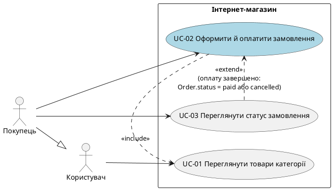

# Розмова — Завдання 2, частина 2 (після нових вимог і AI-CHECK)

Продовження файлу `conversation-lab2.md`. Починається з моменту, коли викладач оновив умову завдання, а перша здача отримала AI-CHECK «не пройдено». Нижче всі повідомлення по черзі: ваші промпти і відповіді Claude. Внутрішні виклики інструментів (читання архіву, пам'ять) не наводяться. Документи, які ви вставляли в повідомлення (spec.md), позначені коротко, бо їхній вміст є у ваших файлах.

---

## 1. Користувач

*(до повідомлення додано: скриншот оновленої умови завдання, архів `kpilab-master_1.zip` з репозиторієм і текст відгуку AI-CHECK)*

**Оновлена умова (зі скриншота).** «Завдання 2 — Вимоги та Use Cases (UC + Gherkin + EARS + NFR)», 16 балів, термін здачі: завтра, 23:59.

- **Мета:** структуровані вимоги, сценарії використання і трасування, вглиб ОДНОГО прецедента.
- **Обов'язкові частини:** UC-діаграма; сценарії в Gherkin; функціональні вимоги в EARS; нефункціональні вимоги (NFR); матриця трасування. User story і Gherkin-сценарій це один артефакт: user story пишеться одразу в Gherkin, окремого розділу «User stories» немає.
- **Порядок:** прецеденти (UC) → сценарії (user stories, записані в Gherkin) → вимоги під ці сценарії.
- **Що зробити:**
  - spec.md: актори та їхні цілі визначаються аналізом домену. Система не є актором; зовнішня система це актор лише тоді, коли сама ініціює взаємодію (платіжний шлюз, служба доставки, email-сервіс «бо потрібні» це деталі реалізації).
  - Use-case-діаграма (PlantUML / Mermaid) з include/extend і узагальненням акторів. UC це потреба актора, не дія системи («перевірити роль», «валідувати параметри» не UC).
  - Обрати один складніший UC: 2–3 сценарії в Gherkin (Given/When/Then), альтернативні шляхи однієї потреби, включно з помилковими. Це і є user stories, окремо від Gherkin вони не пишуться.
  - EARS-вимоги лише для цих сценаріїв.
  - Нефункціональні вимоги ОБОВ'ЯЗКОВО (без NFR робота не зараховується), окремим блоком, кожна з числами й межами (хто, з яких пристроїв, навантаження з межами, час відгуку, безпека, мова, технологія). NFR не наносяться на діаграму і не трасуються.
  - Розділ «Поза обсягом»: що свідомо не робиться і чому.
  - Матриця трасування «вимога-id ↔ сценарій/UC» (Markdown): багато-до-багатьох; непокриті вимоги/UC з обґрунтуванням.
  - Аудит: EARS і NFR на двозначність; include/extend/узагальнення; звірити акторів і сутності з моделлю даних (Завдання 1); топ-3 розбіжності.
  - DEFENSE.md: чому такі межі сценаріїв, як вирішено спірні місця.
- **Ознаки відмінного виконання:** один UC розписано вглиб кількома сценаріями; вимоги однозначні й тестовані; змістовні NFR із числами й межами; трасування багато-до-багатьох; актори й UC без деталей реалізації; узгодженість з моделлю даних.
- **Якщо з AI:** AI не є джерелом вимог і рішень, йому ставиться задача аналізу й добору (знайти прогалини, поставити уточнювальні питання, запропонувати варіанти), а формулює й вирішує студент; spec.md і DEFENSE.md власноруч (DoD §1).

**Відгук AI-CHECK (текст, доданий до повідомлення):**

> AI-CHECK: не пройдено. Цей відгук згенеровано AI за результатами автоматичної перевірки.
>
> Завдання 2 «Вимоги та Use Cases (UC + Gherkin + EARS + NFR)»: відгук
>
> Ви описали інтернет-магазин із Завдання 1 (User, Category, Product, Order, OrderItem): 16 EARS-вимог, 12 Gherkin-сценаріїв, use-case-діаграму в PlantUML з рендером, матрицю трасування, аудит і два ADR. Роботу виконано з AI (Claude), повний діалог збережено в lab2/ai/conversation-lab2.md. Посилання на репозиторій linamalina238/kpilab є лише в DEFENSE; у ньому 21 коміт у lab2/ за 16–18.10, PR немає.
>
> Що вдалося. Аудит справжній і простежуваний: три помилки AI (Then повторює Given; extend для самостійної цілі; Адміністратор без ролі в моделі) описано в ai/errors.md з вашим дослівним фідбеком і виправлено зміною входу — критеріями 9–11 у spec.md (4f05ded, 518342c, 0d1ed28), а потім артефактами (589d087, dad827a, d7730ce, a530759). Усі SHA з DEFENSE існують і змінюють саме те, що заявлено. Оплату розписано вглиб: підтвердження, відмова, таймаут 30 с і пізня відповідь. ADR 0001 порівнює три варіанти з наслідками, а звірка з моделлю Завдання 1 (AUDIT.md, розділ 3) чесно виносить роль як «ПРОПОЗИЦІЯ: User.role», не змінюючи моделі. Відкриті питання (межа рівно 30 с, оплата після скасування) зафіксовано, а не приховано.
>
> Чому роботу не зараховано. За уточненими 22.10 вимогами до завдання блок нефункціональних вимог обов'язковий («робота без NFR не вважається виконаною»), а в репозиторії й DEFENSE його немає: жодної вимоги до часу відгуку, навантаження, пристроїв, мови чи безпеки. Таймаут 30 с — це функціональне правило оплати, а не NFR.
>
> Що потрібно виправити.
> • Блок NFR. Окремим розділом після EARS (наприклад, у EARS.md або nfr.md): хто й з яких пристроїв/браузерів користується, мова інтерфейсу, час відгуку (p95 з профілем запитів, обсягом і тривалістю вимірювання), навантаження «щонайменше N» з очікуваним діапазоном і поведінкою понад межу, безпека. Кожна вимога однозначна, з числами й межами. NFR не наносяться на діаграму і не входять до матриці.
> • Обраний UC. Явно назвіть один UC, який розписано вглиб (фактично це «Оформити й оплатити замовлення», US-1), і покажіть для нього шлях «user story → усі її сценарії → вимоги». Інші сценарії можуть лишатися, але фокус має бути видно.
> • Актори. «Користувач» не має власного UC, тож це фіктивний загальний актор: або дайте йому спільний UC (наприклад, перегляд каталогу), або приберіть. «Оплатити замовлення» зараз пов'язано лише з Платіжним сервісом, хоча оплачує Покупець; «Відхилити пізню відповідь» — реакція системи, а не потреба актора, тож її краще залишити вимогою REQ-10.
> • spec.md і DEFENSE.md — власноруч. З листопада це обов'язкова вимога: spec.md і DEFENSE пишете ви, а AI лише аналізує й ставить уточнювальні питання. У цій роботі першу версію spec.md (тіло й критерії 1–8) надрукував AI з вибраних вами критеріїв (ai/conversation-lab2.md, крок 4); критерії 9–11 і DEFENSE написано власноруч — так і тримайте. Позначте у сліді, що саме написано вами.
> • Дрібне. Здавайте посилання на GitHub (краще на PR) у Classroom, а не лише в тексті DEFENSE; додавайте до AI-комітів трейлер Co-Authored-By; «Поза скоупом» доповніть причинами.

> Виникла проблема, викладач оновив вимоги завдання, будь ласка, подовишь що в мене вже зроблено та дай мені план роботи як доробити\переробити.

## 2. Claude

Читаю решту файлів репозиторію (аудит, помилки AI, сліди розмови), щоб скласти план. Попередня команда обрізала текст посеред символу, тож повторюю її безпечніше.

Основа сильна: аудит, трасування, ADR і слід роботи з AI вже є. Нова редакція міняє форму: замість ширини по всьому магазину потрібна глибина в одному UC плюс блок NFR. Тому це звуження й доповнення, а не переробка з нуля. Дедлайн завтра, 24.10 о 23:59, і за порядком нижче це реально встигнути.

### Що вже зроблено і що з цим робити

| Артефакт | Стан щодо нових вимог |
|---|---|
| `spec.md` | **Переписати самій.** Платіжний сервіс записаний актором, а за новим правилом зовнішня система є актором лише тоді, коли сама ініціює взаємодію. «Поза скоупом» без причин. «Намір» каже, що кожна вимога має сценарій, а критерій 6 це допускає. Критерію про NFR немає. Першу версію тіла й критеріїв 1–8 надрукував я. |
| `usecase-diagram.puml` + `.png` | Include, extend і узагальнення є. Треба прибрати UC-07 (це реакція системи, а не потреба актора), вирішити питання з «Користувачем» без власного UC і з «Оплатити замовлення», пов'язаним лише з Платіжним сервісом. PNG перегенерувати. |
| `user stories.md` | **Прибрати.** Окремого розділу user stories більше немає, історія пишеться в Gherkin. |
| `gherkin.feature` | 12 сценаріїв на 6 UC, а потрібно 2–3 на одному UC. Then із видимою реакцією вже виправлені, це лишається. |
| `EARS.md` | 16 вимог на всі UC, а потрібні лише вимоги під сценарії обраного UC, приблизно 7–8. NFR немає зовсім. |
| `traceability.md` | Формат правильний (багато-до-багатьох, непокриті з поясненням). Перебудувати під менший набір. |
| `AUDIT.md`, `ai/errors.md` | Слід справжній, але аудит треба звести на новий набір артефактів і додати перевірку NFR на двозначність. |
| ADR 0001 (таймаут) | Лишається, якщо таймаут залишиться сценарієм. |
| ADR 0002 (role) | Залежить від того, чи лишиться Адміністратор у вимогах. |
| `lab2/DEFENSE.md` | У моєму знімку (zip від 18.10) його немає, а відгук каже, що він є. Тож його я не бачив і не оцінюю. |

### План (за порядком, приблизно 5–6 годин)

1. **Рішення про межі (30 хв).** Спершу ухвали чотири рішення, про які нижче, бо від них залежить усе інше.
2. **`spec.md` (1 год, сама).** Актори й цілі з аналізу домену, межі, сутності, критерії. Додай розділ «Поза обсягом» з причинами і критерії для NFR. Поправ критерії 1 і 7, які зараз вимагають зовнішню систему як актора.
3. **Діаграма (30 хв).** Прибери UC-07, розв'яжи «Користувача», перевір, що UC названі як потреби актора. Перегенеруй PNG. Інші UC можуть лишатися на діаграмі, бо вглиб розписується лише один.
4. **Gherkin (45 хв).** Один UC, 2–3 сценарії: успішний, помилковий і, можливо, таймаут. User story пишеться в описі `Feature:`. Файл `user stories.md` видали. Решту сценаріїв перенеси в «Поза обсягом».
5. **EARS (45 хв).** Залиш вимоги лише під ці сценарії. Решту перелічи в «Поза обсягом» з причиною.
6. **NFR (1 год, сама).** Окремий блок, поза діаграмою і поза матрицею. Теми з завдання: хто користується і з яких пристроїв чи браузерів, мова, час відгуку (p95 з профілем запитів, обсягом і тривалістю вимірювання), навантаження «щонайменше N» з очікуваним діапазоном і поведінкою понад межу, безпека, технологія. Кожна вимога з числами й межами. Таймаут 30 с це функціональне правило, а не NFR.
7. **Матриця (30 хв).** Перебудуй, непокриті вимоги й UC лишай з обґрунтуванням.
8. **Аудит (1 год).** EARS і NFR на двозначність, include/extend/узагальнення, актори й сутності проти моделі Завдання 1, топ-3 розбіжності. Кожну виправляй через зміну `spec.md`, окремим комітом.
9. **ADR і DEFENSE (45 хв, сама).** ADR на ключове рішення (хоча б вибір UC) і DEFENSE: чому такі межі сценаріїв.
10. **Гігієна репозиторію (15 хв).** Посилання на PR здай у Classroom, а не лише в тексті DEFENSE. Додай `Co-Authored-By` до комітів, де працював AI. У lab1 є вкладені `ADR/ADR/ADR/`, їх варто спростити до `ADR/`. У сліді `ai/` познач, що саме написано тобою.

### Рішення, які мусиш ухвалити ти

- **Який UC розписуєш вглиб.** Відгук підказує «Оформити й оплатити замовлення» (US-1). Тоді або лишаєш пару UC-02 include UC-03 і явно називаєш її обраним прецедентом, або зливаєш у один UC (тоді треба знайти інше місце для include).
- **Чи Платіжний сервіс актор.** Тепер система сама надсилає запит і чекає відповідь, тобто він не ініціює. Якщо підтвердження приходить як його зворотний виклик, ініціює він. Обидва варіанти можливі, але в `spec.md` треба записати, чому ти обрала саме так. Від цього залежить і питання, хто пов'язаний з «Оплатити замовлення» (оплачує Покупець).
- **«Користувач».** Або дай йому спільний UC (наприклад, «Переглянути товари категорії», який може і Покупець, і Адміністратор), або приберіть. Узагальнення акторів на діаграмі все одно потрібне.
- **Що з REQ-10 і роллю.** Пізня відповідь за відгуком краще лишається вимогою, а не UC. Якщо Адміністратор виходить за обсяг, то User.role, REQ-13, 14 і 16 теж йдуть у «Поза обсягом».

### Моя роль у переробці

За новими правилами spec.md і DEFENSE.md пишеш сама, а рішення ухвалюєш ти. Я можу знаходити прогалини, ставити уточнювальні питання, пропонувати варіанти і перевіряти написане, але не писати ці файли замість тебе. Тому для NFR я не вигадуватиму цифр, а допоможу з'ясувати, які вони мають бути.

З якого кроку починаємо: з чотирьох рішень про межі чи одразу з `spec.md`?

---

## 3. Користувач

> давай обговоримо uc бо я хочу зрозуміти що це по цьому завданню і який обрати. ось що в мене вже є: інтернет магазин з лаби 1 (user category product order orderitem статуси pending paid shipped cancelled). зараз у мене діаграма з 7 uc: переглянути товари категорії, оформити замовлення, оплатити замовлення, скасувати замовлення, позначити замовлення відправленим, додати товар, відхилити пізню відповідь. актори покупець адміністратор платіжний сервіс і користувач (спільний тип для покупця і адміністратора)

## 4. Claude

### Що таке UC за цим завданням

UC відповідає на питання «навіщо актор прийшов», а не «як система це робить». У банкоматі UC це «зняти готівку», а «перевірити PIN» це крок усередині. Перевір кожен UC трьома питаннями:

1. Це потреба самого актора, а не реакція системи?
2. Після нього актор може сказати «готово», і це одна ціль?
3. До цієї цілі ведуть кілька шляхів, зокрема помилкові? Це потрібно лише для того UC, який ти розписуєш вглиб (2–3 сценарії).

### Твої 7 UC за цими питаннями

| UC | Потреба актора? | Шляхів до цілі | Зауваження |
|---|---|---|---|
| Переглянути товари категорії | так | мало (є товари / порожня категорія) | простий |
| Оформити замовлення | так | успіх, quantity < 1, порожнє | помилки тут про перевірку введення |
| Оплатити замовлення | **частково** | успіх, відмова, таймаут | Покупець хоче «купити», а не «оформити» і «оплатити» окремо; зараз пов'язаний лише з Платіжним сервісом |
| Скасувати замовлення | так | pending → cancelled, shipped → відмова | для paid правила немає |
| Позначити відправленим | так | paid → shipped | залежить від пропозиції User.role |
| Додати товар | так | успіх, неіснуюча категорія | другий шлях вирішує сама БД через FK |
| Відхилити пізню відповідь | **ні** | — | реакція системи, як «перевірити PIN»; це вимога, не UC |

### Який обрати вглиб

- **«Оформити й оплатити замовлення» (Покупець).** Має найбагатший набір шляхів: успіх, оплату відхилено, Платіжний сервіс не відповів 30 с (пізня відповідь лишається вимогою). Зачіпає Order, OrderItem, Product і три статуси. Саме його називає відгук, і він уже найглибше розписаний. Залишається вирішити, як це відобразити на діаграмі: або злити UC-02 і UC-03 в один, або лишити пару з include і вважати прецедентом обидва разом.
- **«Скасувати замовлення».** Шляхів лише два-три, а третій (paid) потребує рішення про повернення коштів, якого в моделі немає. Це більше ризик, ніж користь.
- **Адміністраторські UC.** Мало розгалужень, і вони тягнуть User.role, якої немає в моделі.

За критерієм «складніший» найближчий перший варіант, але вибір твій.

### Що це змінить на діаграмі

- UC-07 зникає, а REQ-10 лишається вимогою.
- Решта UC можуть лишитися на діаграмі, бо вглиб розписується лише один. Решта потрапить у «Поза обсягом» і в матрицю як непокриті UC з обґрунтуванням.
- Для «Користувача» з'являється шанс отримати спільний UC: «Переглянути товари категорії» міг би бути пов'язаний з ним, а не з Покупцем.
- Приклади з завдання (платіжний шлюз, служба доставки) названі деталями реалізації, якщо вони самі нічого не ініціюють.

Головне питання від нього залежить усе інше: чи Платіжний сервіс колись сам починає взаємодію з системою (наприклад, надсилає підтвердження оплати без запиту), чи тільки відповідає на запит?

---

## 5. Користувач

*(до повідомлення додано spec.md, який користувачка склала сама; вміст є у її файлі)*

> оціни мій спек. тепер uc діаграма. не малюй її поки, спершу варіанти а я вирішу обраний прецедент оформити й оплатити замовлення. актори користувач і покупець (покупець спеціалізація користувача). платіжний сервіс не актор бо система сама робить запит і чекає відповідь проблема в тому що за критерієм 10 на діаграмі має бути include extend і узагальнення акторів. а прецедент один. uc має бути потребою актора а не кроком системи (перевірити роль валідувати параметри це не uc) 1 запропонуй 3 варіанти які uc лишити на діаграмі поруч з обраним щоб були include і extend і при цьому кожен uc був потребою актора і без технічних деталей. для кожного варіанта скажи плюси і мінуси 2 для кожного варіанта поясни чому саме include а чому extend і яка там умова 3 скажи який uc має бути у користувача щоб узагальнення мало сенс 4 спитай мене що ти ще не знаєш сутності тільки з моєї моделі user category product order orderitem.

## 6. Claude

### Оцінка спеку

Він стислий, один прецедент названий явно, Платіжний сервіс пояснений за правилом «сам не ініціює», а сутності зі статусами збігаються з моделлю. Це добра основа. Є кілька проблем, які варто виправити, перш ніж будувати діаграму.

1. **Обґрунтування в «Поза обсягом» хибні для частини пунктів.**
   - Пункт 2: позначка `shipped` не потребує повернення коштів, і скасування `pending` теж. Повернення кошти потрібне лише для `paid`.
   - Пункт 3: ти пишеш «потрібна зміна попередньої роботи», але в тебе ж написано, що розширення позначається як ПРОПОЗИЦІЯ, тобто модель не змінюється. Чесніша причина: це не стосується обраного прецеденту.
2. **p95 ≤ 500 ms неоднозначний.** У тому самому прецеденті оплата чекає до 30 с, тож незрозуміло, яка саме операція має вкластися в 500 ms. Відгук також вимагає профіль запитів, обсяг і тривалість вимірювання. Цифри краще тримати в блоці NFR, а в критерії писати лише «є NFR з числами й межами».
3. **Критерії без номерів.** AUDIT посилатиметься на «критерій N», тож пронумеруй їх.
4. **Слово «валідним» у `user_id` розмите.** Напиши «існуючого User».
5. **Правила про акторів ніде не перевіряються.** Додай критерій «система не актор, зовнішня система актор лише якщо ініціює».
6. **Вирішити, чи лишаються критерії 9 і 10 зі старої версії.** На них спиралися AUDIT і коміти, а тепер їх немає. Якщо вилучаєш, аудит треба перебудувати.
7. **Платіжний сервіс** краще винести з розділу «Актори» в окрему примітку «Не актори».

### Діаграма: UC, які можуть лишитися поруч із обраним

Обмеження: актори лише Користувач і Покупець, тому адміністраторських UC немає. Усі UC названі як потреби, без «увійти», «перевірити роль» чи «валідувати».

Позначення: A = «Переглянути товари категорії» (Користувач), B = «Оформити й оплатити замовлення» (Покупець, обраний), C = «Переглянути свої замовлення» (Покупець), D = «Скасувати замовлення» (Покупець), E = «Знайти товар за назвою» (Користувач).

**Варіант 1. Навколо вибору товару.** UC: A, B, E.
- `B ── include ──> A`. Перш ніж оформити замовлення, Покупець завжди вибирає Product із перегляду, а A є окремою потребою, яку B повторно використовує. Умови немає, бо include відбувається завжди.
- `E ── extend ──> A`. Перегляд завершується і без пошуку. Умова: `(Користувач знає Product.name)`.
- **Плюси.** Умова extend перевіряється чітко. Обидва UC працюють лише з Category і Product.
- **Мінуси.** Пошук це нова можливість, якої немає в спеці, тому він піде в матрицю як непокритий UC. Твердження «завжди проходить через перегляд» треба вміти захистити.

**Варіант 2. Замовлення Покупця.** UC: A, B, C, D.
- `D ── include ──> C`. Щоб скасувати, Покупець завжди спершу відкриває свої замовлення, а C використовується й окремо. Умови немає.
- `C ── extend ──> B`. Після оплати Покупець може подивитись результат. Основний UC завершується і без цього. Умова: `(Покупець хоче побачити результат оплати)`.
- **Плюси.** Усе крутиться навколо Order і OrderItem, і діаграма пов'язує обраний UC з рештою.
- **Мінуси.** D суперечить пункту 2 «Поза обсягом», тож його треба переформулювати як «не розписано вглиб». Умова extend описує бажання, а не стан системи. C одночасно included і extension, і це заплутує.

**Варіант 3. Мінімальний.** UC: A, B, C.
- `B ── include ──> A`, `C ── extend ──> B`. Обґрунтування й умови ті самі, що у варіантах 1 і 2.
- **Плюси.** Найменше нового, лише один новий UC (C), і всі вони з твоєї моделі.
- **Мінуси.** Діаграма тонка. Include «завжди» треба захищати, а умова extend про бажання.

Я не пропонував розбити B на «Оформити» і «Оплатити» з include між ними. Це розкладання на кроки, а ти вже обрала єдиний прецедент.

### UC Користувача для узагальнення

Узагальнення має сенс, коли в батька є власний UC, який Покупець успадковує, а в дитини є свій. Тут це A, «Переглянути товари категорії» (у спеці ціль Користувача саме така). Покупець успадковує перегляд і додає B. Актор без жодного UC був би фіктивним, як у відгуку.

### Що я ще не знаю

1. Чи справді Покупець у твоєму сценарії обирає Product із перегляду категорії перед оформленням (від цього залежить, чи витримує include B → A)?
2. Користувач це будь-який відвідувач чи лише той, для кого існує запис User? У спеці написано «існуючий User», але перегляд товарів виглядає доступним і без нього.
3. Чи можуть на діаграмі бути UC, яких немає в спеці або які ти назвала «Поза обсягом» (D, C, E), якщо в матриці вони стоятимуть як непокриті з поясненням?
4. Чи хочеш показати на діаграмі цей фокус (один UC вглиб), а решту мінімальними?

---

## 7. Користувач

*(до повідомлення додано оновлений spec.md користувачки)*

> перевір новий spec. зроби за один раз усі файли, кожен окремим блоком коду з назвою файлу зверху, нічого крім файлів не пиши
>
> 1 usecase-diagram.puml (plantuml). актори користувач і покупець, покупець спадкує від користувача (--|>). платіжний сервіс на діаграмі не малюй. прецеденти з номерами в назві:
> UC-01 Переглянути товари категорії (користувач)
> UC-02 Оформити й оплатити замовлення (покупець) це мій обраний
> UC-03 Переглянути статус замовлення (покупець)
> include від UC-02 до UC-01. extend від UC-03 до UC-02 з умовою в дужках: оплату завершено, order.status paid або cancelled. include йде від основного uc до включеного, extend від розширення до основного
>
> 2 gherkin.feature. в описі feature коротка user story: як покупець я хочу... щоб... рівно 3 сценарії для UC-02: успішна оплата не пізніше ніж за 30 с, відмова платіжного сервісу, відповіді немає понад 30 с. є background з даними моєї моделі. над кожним сценарієм теги @REQ-xx. then описує видиму зміну чи реакцію і не повторює given. межа: 30 с і менше це успіх, понад 30 с це таймаут
>
> 3 EARS.md. 6-8 вимог REQ-01... таблицею id | текст | шаблон | сутність. шаблони when і if-then, рівно одне SHALL, жодних слів швидко зручно безпечно кілька тощо, тільки сутності з моделі. вимоги під ці 3 сценарії і критерії 1-5 зі spec. одна вимога може лишитись без сценарію, але поясни чому по-справжньому
>
> 4 nfr.md окремий блок. кожна вимога з числами і межами. теми: пристрої і браузери (десктоп і мобільні, версії), мова інтерфейсу українська, час відгуку p95 не більше 500 мс для створення order без очікування платіжного сервісу (вкажи профіль запитів, обсяг, тривалість вимірювання), навантаження мінімум 50 одночасних сесій з очікуваним діапазоном і що робить система понад межу, безпека https і що саме захищаємо. таймаут 30 с це не nfr
>
> 5 traceability.md. таблиця req-id | сценарій | uc. багато-до-багатьох: є вимога в двох сценаріях і сценарій з двома вимогами. nfr не включай. познач непокриті вимоги і uc (UC-01 і UC-03 без сценарію) з чесним поясненням, не підганяй
>
> сутності тільки з моєї моделі, нове познач ПРОПОЗИЦІЯ. поза обсягом не чіпай

## 8. Claude

`usecase-diagram.puml`


`gherkin.feature`
```gherkin
Feature: Оформити й оплатити замовлення
  Як Покупець
  я хочу оформити замовлення й оплатити його
  щоб отримати обрані товари

  # UC-02. Межа таймауту: 30 с і менше це успіх, понад 30 с це таймаут.

  Background:
    Given існує User з name "Олена" і email "olena@example.com"
    And існує Category з name "Електроніка"
    And існує Product з name "Навушники", price 1200.00 і category_id категорії "Електроніка"

  @REQ-01 @REQ-03 @REQ-04 @REQ-05 @REQ-06
  Scenario: Оплата підтверджена не пізніше ніж за 30 с
    Given Покупець "Олена" обрав 2 шт. Product "Навушники"
    When Покупець оформлює замовлення
    Then створено Order для User "Олена" зі статусом pending
    And створено один OrderItem з quantity 2 і unit_price 1200.00
    And Платіжному сервісу надіслано запит на оплату суми 2400.00
    When Платіжний сервіс підтверджує оплату рівно через 30 с після запиту
    Then статус Order дорівнює paid

  @REQ-05 @REQ-07
  Scenario: Платіжний сервіс відхиляє оплату
    Given Покупець "Олена" обрав 2 шт. Product "Навушники"
    When Покупець оформлює замовлення
    And Платіжний сервіс відхиляє оплату через 10 с після запиту
    Then Платіжному сервісу надіслано запит на оплату суми 2400.00
    And статус Order дорівнює cancelled

  @REQ-05 @REQ-08
  Scenario: Відповіді немає понад 30 с
    Given Покупець "Олена" обрав 2 шт. Product "Навушники"
    When Покупець оформлює замовлення
    And від Платіжного сервісу немає відповіді 31 с після запиту
    Then Платіжному сервісу надіслано запит на оплату суми 2400.00
    And статус Order дорівнює cancelled
```

`EARS.md`
```markdown
# Вимоги EARS — UC-02 «Оформити й оплатити замовлення»

| id | текст | шаблон | сутність |
|---|---|---|---|
| REQ-01 | WHEN Покупець оформлює замовлення з ≥1 позицією, система SHALL створити Order зі статусом pending і user_id цього Покупця. | WHEN | Order (user_id, status = pending), User |
| REQ-02 | WHEN система створює Order, система SHALL записати в created_at поточні дату й час. | WHEN | Order.created_at |
| REQ-03 | WHEN система створює Order, система SHALL створити один OrderItem з quantity ≥ 1 шт. на кожен обраний Product. | WHEN | Order, OrderItem.quantity, Product |
| REQ-04 | WHEN система створює OrderItem, система SHALL записати в unit_price значення Product.price на цей момент. | WHEN | OrderItem.unit_price, Product.price |
| REQ-05 | WHEN Order створено зі статусом pending, система SHALL надіслати Платіжному сервісу запит на оплату суми добутків quantity × unit_price усіх OrderItem цього Order. | WHEN | Order (status = pending), OrderItem |
| REQ-06 | WHEN Платіжний сервіс підтверджує оплату не пізніше ніж через 30 с після запиту, система SHALL змінити статус Order з pending на paid. | WHEN | Order.status: pending → paid |
| REQ-07 | WHEN Платіжний сервіс відхиляє оплату не пізніше ніж через 30 с після запиту, система SHALL змінити статус Order з pending на cancelled. | WHEN | Order.status: pending → cancelled |
| REQ-08 | IF Платіжний сервіс не відповідає понад 30 с після запиту, THEN система SHALL змінити статус Order з pending на cancelled. | IF-THEN | Order.status: pending → cancelled |

Межа таймауту: відповідь через 30 с і менше це успіх або відмова (REQ-06, REQ-07), відповідь пізніше за 30 с це таймаут (REQ-08).

ПРОПОЗИЦІЙ немає: усі сутності, атрибути й статуси взято з моделі Лаби 1.

## Вимога без сценарію

**REQ-02.** Значення `created_at` задає годинник сервера в момент створення Order, тому сценарій Gherkin не може вказати точне очікуване значення, не фіксуючи час у тесті. Жоден із трьох сценаріїв це поле не перевіряє. Вимога лишається для модульного тесту: поле не порожнє й відрізняється від поточного часу не більше ніж на 5 с.
```

`nfr.md`
```markdown
# Нефункціональні вимоги (NFR)

NFR не наносяться на діаграму й не входять до матриці трасування. Таймаут 30 с це функціональне правило (REQ-06, REQ-07, REQ-08), а не NFR.

## NFR-01. Пристрої та браузери
- **Хто:** Користувачі й Покупці, які відкривають магазин у браузері.
- **Десктоп:** ширина вікна від 1280 px. Chrome, Edge і Firefox: поточна й одна попередня основна версія. Safari 17 і новіша на macOS.
- **Мобільні:** ширина екрана від 360 px до 430 px. Chrome на Android 12 і новіша. Safari на iOS 17 і новіша.
- **Межа:** Internet Explorer і версії старші за зазначені не підтримуються й не тестуються.
- **Перевірка:** оформлення замовлення (UC-02) проходить без помилок на кожній комбінації з цього переліку.

## NFR-02. Мова інтерфейсу
- Увесь текст інтерфейсу українською: 0 рядків іншою мовою, окрім значень `Product.name` і `Category.name`, які показуються як збережені.
- Дата у форматі ДД.ММ.РРРР, час у 24-годинному форматі.
- Інші мови інтерфейсу не підтримуються.

## NFR-03. Час відгуку
- **Операція:** створення Order з OrderItem, від приймання запиту сервером до відправлення відповіді клієнту, без очікування Платіжного сервісу.
- **Межа:** p95 ≤ 500 мс.
- **Профіль запитів:** 50 одночасних сесій, кожна створює Order раз на 30 с; у замовленні від 1 до 5 позицій (медіана 2).
- **Обсяг:** близько 1,7 запиту за секунду, не менше 3000 запитів у вимірюванні.
- **Тривалість:** 30 хв сталого навантаження після розігріву в 5 хв, розігрів у вимірювання не входить.
- **Стан бази під час вимірювання:** 10 000 Product, 1 000 User, 50 000 Order.
- **Додаткова межа:** відповіді з помилкою сервера (клас 5xx) не більше 1% запитів у цьому ж вимірюванні.

## NFR-04. Навантаження
- **Мінімум:** 50 одночасних сесій без порушення NFR-03. Одночасна сесія це сесія із запитом за останні 5 хв.
- **Очікуваний діапазон:** від 10 до 30 одночасних сесій у звичайні години, до 50 у піку.
- **51–100 сесій:** система приймає запити, p95 створення Order ≤ 2000 мс.
- **Понад 100 сесій:** нові сесії отримують відповідь HTTP 503 з повідомленням українською, наявні сесії продовжують працювати, уже створені Order не втрачаються.

## NFR-05. Безпека
- Усі запити йдуть через HTTPS з TLS версії 1.2 або вищої. Запит по HTTP система перенаправляє на HTTPS (код 301).
- **Що захищаємо:** `User.name` і `User.email`; склад Order і OrderItem (`quantity`, `unit_price`); суми замовлень. Ці дані передаються лише через HTTPS.
- Покупець бачить і змінює лише ті Order, у яких `Order.user_id` дорівнює його `User.id`. Спроба доступу до чужого Order отримує відповідь HTTP 403.
- Номери банківських карток система не отримує й не зберігає (у моделі немає відповідних полів). Оплата відбувається на боці Платіжного сервісу.

## Припущення, які потрібно підтвердити або змінити
Значення нижче в завданні не були задані, я вибрав їх як робочі:
- NFR-01: межі версій браузерів, ширина вікна й екрана.
- NFR-02: формат дати й часу.
- NFR-03: профіль запитів, обсяг, тривалість вимірювання, стан бази, межа 1% для 5xx.
- NFR-04: діапазон 10–30 і 50, межі 51–100 і понад 100, поведінка HTTP 503.
- NFR-05: версія TLS, код 301, код 403.
```

`traceability.md`
```markdown
# Матриця трасування

| req-id | сценарій | uc |
|---|---|---|
| REQ-01 | Оплата підтверджена не пізніше ніж за 30 с | UC-02 |
| REQ-02 | немає | UC-02 |
| REQ-03 | Оплата підтверджена не пізніше ніж за 30 с | UC-02 |
| REQ-04 | Оплата підтверджена не пізніше ніж за 30 с | UC-02 |
| REQ-05 | Оплата підтверджена не пізніше ніж за 30 с; Платіжний сервіс відхиляє оплату; Відповіді немає понад 30 с | UC-02 |
| REQ-06 | Оплата підтверджена не пізніше ніж за 30 с | UC-02 |
| REQ-07 | Платіжний сервіс відхиляє оплату | UC-02 |
| REQ-08 | Відповіді немає понад 30 с | UC-02 |

Зв'язки багато-до-багатьох: REQ-05 входить у три сценарії, а сценарій «Оплата підтверджена не пізніше ніж за 30 с» покриває п'ять вимог (REQ-01, REQ-03, REQ-04, REQ-05, REQ-06). NFR у матрицю не входять.

## Непокриті вимоги та UC

- **REQ-02:** жоден сценарій не перевіряє `created_at`, бо точне значення часу в Gherkin без фіксації годинника в тесті задати неможливо. Вимога лишається для модульного тесту.
- **UC-01 «Переглянути товари категорії»:** без сценарію і без вимог. Прецедент розписано вглиб лише для UC-02, а жодна з вимог EARS не описує показ товарів. Зв'язок include з UC-02 існує на діаграмі (Покупець вибирає Product із перегляду), але в матриці він не підкріплений вимогою. Це відкрита прогалина: або додати вимогу на показ Product за category_id, або вважати, що include підтверджено лише діаграмою.
- **UC-03 «Переглянути статус замовлення»:** без сценарію і без вимог. Сценарії перевіряють зміну `Order.status`, але не те, що Покупець бачить статус, і вимоги про показ статусу немає. Extend до UC-02 існує лише на діаграмі.
```

---

## 9. Користувач

*(до повідомлення додано spec.md з новими критеріями 12, 13, 14)*

> дякую файли майже ок. є три речі які треба переробити. я додала в spec критерії 12 13 14 1 req-02 ти лишив без сценарію бо created_at не можна перевірити в gherkin. але можна перевірити діапазоном. додай у перший сценарій перевірку що created_at не раніше моменту оформлення і не пізніше моменту перевірки з тегом @REQ-02 і прибери пояснення про модульний тест з EARS.md і traceability.md 2 у сценаріях відмова і таймаут then про надісланий запит стоїть після відповіді сервісу тобто виходить що запит надіслано після відмови. запит оплати має бути в given а then має описувати тільки реакцію на відповідь. перероби порядок кроків 3 uc-01 і uc-03 на діаграмі без вимог і сценаріїв і include та extend ні на чому не тримаються. додай вимоги на показ product за category_id і на показ order.status покупцю. у перший сценарій додай крок що покупець відкрив категорію і обрав товар з неї. онови traceability видай тільки змінене

## 10. Claude

`gherkin.feature`
```gherkin
Feature: Оформити й оплатити замовлення
  Як Покупець
  я хочу оформити замовлення й оплатити його
  щоб отримати обрані товари

  # UC-02. Межа таймауту: 30 с і менше це успіх, понад 30 с це таймаут.
  # У першому сценарії також перевіряються UC-01 (перегляд категорії) і UC-03 (перегляд статусу).

  Background:
    Given існує User з name "Олена" і email "olena@example.com"
    And існує Category з name "Електроніка"
    And існує Product з name "Навушники", price 1200.00 і category_id категорії "Електроніка"

  @REQ-01 @REQ-02 @REQ-03 @REQ-04 @REQ-05 @REQ-06 @REQ-09 @REQ-10
  Scenario: Оплата підтверджена не пізніше ніж за 30 с
    Given існує Category з name "Одяг"
    And існує Product з name "Футболка", price 500.00 і category_id категорії "Одяг"
    When Покупець "Олена" відкриває Category "Електроніка"
    Then Покупцю показано Product "Навушники"
    And Product "Футболка" не показано
    When Покупець обирає з цієї категорії 2 шт. Product "Навушники" і оформлює замовлення
    Then створено Order для User "Олена" зі статусом pending
    And значення Order.created_at не раніше моменту оформлення замовлення і не пізніше моменту цієї перевірки
    And створено один OrderItem з quantity 2 і unit_price 1200.00
    And Платіжному сервісу надіслано запит на оплату суми 2400.00
    When Платіжний сервіс підтверджує оплату рівно через 30 с після запиту
    Then статус Order дорівнює paid
    When Покупець відкриває цей Order
    Then Покупцю показано статус Order paid

  @REQ-07 @REQ-10
  Scenario: Платіжний сервіс відхиляє оплату
    Given існує Order зі статусом pending від User "Олена" з одним OrderItem (quantity 2, unit_price 1200.00)
    And Платіжному сервісу надіслано запит на оплату суми 2400.00
    When Платіжний сервіс відхиляє оплату через 10 с після запиту
    Then статус Order дорівнює cancelled
    When Покупець відкриває цей Order
    Then Покупцю показано статус Order cancelled

  @REQ-08 @REQ-10
  Scenario: Відповіді немає понад 30 с
    Given існує Order зі статусом pending від User "Олена" з одним OrderItem (quantity 2, unit_price 1200.00)
    And Платіжному сервісу надіслано запит на оплату суми 2400.00
    When від Платіжного сервісу немає відповіді 31 с після запиту
    Then статус Order дорівнює cancelled
    When Покупець відкриває цей Order
    Then Покупцю показано статус Order cancelled
```

`EARS.md`
```markdown
# Вимоги EARS — UC-02 «Оформити й оплатити замовлення»

| id | текст | шаблон | сутність |
|---|---|---|---|
| REQ-01 | WHEN Покупець оформлює замовлення з ≥1 позицією, система SHALL створити Order зі статусом pending і user_id цього Покупця. | WHEN | Order (user_id, status = pending), User |
| REQ-02 | WHEN система створює Order, система SHALL записати в created_at поточні дату й час. | WHEN | Order.created_at |
| REQ-03 | WHEN система створює Order, система SHALL створити один OrderItem з quantity ≥ 1 шт. на кожен обраний Product. | WHEN | Order, OrderItem.quantity, Product |
| REQ-04 | WHEN система створює OrderItem, система SHALL записати в unit_price значення Product.price на цей момент. | WHEN | OrderItem.unit_price, Product.price |
| REQ-05 | WHEN Order створено зі статусом pending, система SHALL надіслати Платіжному сервісу запит на оплату суми добутків quantity × unit_price усіх OrderItem цього Order. | WHEN | Order (status = pending), OrderItem |
| REQ-06 | WHEN Платіжний сервіс підтверджує оплату не пізніше ніж через 30 с після запиту, система SHALL змінити статус Order з pending на paid. | WHEN | Order.status: pending → paid |
| REQ-07 | WHEN Платіжний сервіс відхиляє оплату не пізніше ніж через 30 с після запиту, система SHALL змінити статус Order з pending на cancelled. | WHEN | Order.status: pending → cancelled |
| REQ-08 | IF Платіжний сервіс не відповідає понад 30 с після запиту, THEN система SHALL змінити статус Order з pending на cancelled. | IF-THEN | Order.status: pending → cancelled |
| REQ-09 | WHEN Користувач обирає Category, система SHALL показати перелік Product з category_id цієї Category. | WHEN | Category, Product.category_id |
| REQ-10 | WHEN Покупець відкриває Order зі статусом paid або cancelled, система SHALL показати йому поточний статус цього Order. | WHEN | Order.status, Order.user_id, User |

Межа таймауту: відповідь через 30 с і менше це успіх або відмова (REQ-06, REQ-07), відповідь пізніше за 30 с це таймаут (REQ-08).

Зв'язки на діаграмі: include UC-02 → UC-01 тримається на REQ-09, extend UC-03 → UC-02 тримається на REQ-10 (умова extend: оплату завершено, Order.status = paid або cancelled).

ПРОПОЗИЦІЙ немає: усі сутності, атрибути й статуси взято з моделі Лаби 1.
```

`traceability.md`
```markdown
# Матриця трасування

| req-id | сценарій | uc |
|---|---|---|
| REQ-01 | Оплата підтверджена не пізніше ніж за 30 с | UC-02 |
| REQ-02 | Оплата підтверджена не пізніше ніж за 30 с | UC-02 |
| REQ-03 | Оплата підтверджена не пізніше ніж за 30 с | UC-02 |
| REQ-04 | Оплата підтверджена не пізніше ніж за 30 с | UC-02 |
| REQ-05 | Оплата підтверджена не пізніше ніж за 30 с | UC-02 |
| REQ-06 | Оплата підтверджена не пізніше ніж за 30 с | UC-02 |
| REQ-07 | Платіжний сервіс відхиляє оплату | UC-02 |
| REQ-08 | Відповіді немає понад 30 с | UC-02 |
| REQ-09 | Оплата підтверджена не пізніше ніж за 30 с | UC-01 |
| REQ-10 | Оплата підтверджена не пізніше ніж за 30 с; Платіжний сервіс відхиляє оплату; Відповіді немає понад 30 с | UC-03 |

Зв'язки багато-до-багатьох: REQ-10 входить у три сценарії, а сценарій «Оплата підтверджена не пізніше ніж за 30 с» покриває вісім вимог (REQ-01…REQ-06, REQ-09, REQ-10). NFR у матрицю не входять.

У сценаріях «Платіжний сервіс відхиляє оплату» і «Відповіді немає понад 30 с» запит на оплату є лише передумовою (Given), а не перевіркою, тому REQ-05 там не вказано.

## Непокриті вимоги та UC

Непокритих вимог і UC немає: кожна з REQ-01…REQ-10 входить принаймні в один сценарій, а UC-01 і UC-03 тримаються на REQ-09 і REQ-10, які перевіряються в сценаріях. Штучно непокритого елемента я не додавав.
```

Вимог тепер 10, бо ти попросила дві нові до наявних восьми. Непокритих вимог і UC більше немає, а критерій 9 у твоєму spec вимагає хоча б одну, тож його формулювання треба змінити (наприклад, «якщо є») або знайти справжню непокриту вимогу.

---

## 11. Користувач

*(до повідомлення додано spec.md з оновленим критерієм 6 і критерієм 9)*

> перепиши nfr.md за моїми рішеннями. числа й рішення мої, не вигадуй своїх. якщо чогось не вистачає, не додумуй а випиши окремим списком питань в кінці, я вирішу сама
>
> що має бути: кожна вимога однозначна з числами й межами. nfr не наносяться на діаграму і не входять у матрицю. таймаут 30 с це функціональне правило а не nfr.  без слів «я вибрав», нейтрально
>
> мої рішення
>
> nfr-01 пристрої і браузери. хто: покупець (зареєстрований user) з комп'ютера або телефона. десктоп ширина вікна від 1280 px. мобільні ширина екрана 360 до 430 px. браузери: поточна і попередня основна версія chrome edge firefox safari на дату приймання роботи, на телефонах chrome на android і safari на ios. ширини 431 до 1279 px, internet explorer і старіші версії не підтримуються й не тестуються. перевірка: оформлення замовлення проходить без помилок на кожній комбінації
>
> nfr-02 мова. весь інтерфейс українською, 0 рядків іншою мовою крім product.name і category.name як вони збережені. дата дд.мм.рррр, час 24-годинний. інших мов нема
>
> nfr-03 час відгуку. операція: створення order з orderitem від приймання запиту сервером до відповіді клієнту, без очікування платіжного сервісу. межа p95 не більше 500 мс. профіль: 50 одночасних сесій, кожна створює order раз на 30 с, від 1 до 5 позицій, медіана 2. обсяг не менше 3000 запитів. тривалість 30 хв після розігріву 5 хв, розігрів не входить. стан бази 10000 product 1000 user 50000 order. помилки 5xx не більше 1 відсотка
>
> nfr-04 навантаження. мінімум 50 одночасних сесій без порушення nfr-03. сесія одночасна якщо був запит за останні 5 хв. очікуваний діапазон 10 до 30 сесій у звичайні години до 50 у піку. 51 до 100 сесій приймаємо, p95 створення order не більше 2000 мс. понад 100 сесій: нові отримують http 503 з повідомленням українською, наявні сесії працюють, створені order не втрачаються
>
> nfr-05 безпека. усі запити https tls 1.2 або вище, запит по http перенаправляється на https (301). захищаємо user.name і user.email, склад і суми order. покупець бачить і змінює лише order де order.user_id дорівнює його user.id, інакше 403. номери карток система не отримує й не зберігає
>
> в кінці розділ «Прийняті припущення»: перелічи значення яких не було в завданні (версії браузерів, профіль запитів, обсяг, стан бази, межі навантаження, коди відповідей) і скажи що вони прийняті як робочі допущення бо реальних даних немає

## 12. Claude

`nfr.md`
```markdown
# Нефункціональні вимоги (NFR)

NFR не наносяться на діаграму й не входять до матриці трасування. Таймаут 30 с є функціональним правилом (REQ-06, REQ-07, REQ-08), а не NFR.

## NFR-01. Пристрої та браузери
- **Хто:** Покупець (зареєстрований User) з комп'ютера або телефона.
- **Десктоп:** ширина вікна від 1280 px.
- **Мобільні:** ширина екрана від 360 до 430 px.
- **Браузери:** поточна і попередня основна версія Chrome, Edge, Firefox і Safari на дату приймання роботи. На телефонах: Chrome на Android і Safari на iOS.
- **Не підтримуються й не тестуються:** ширини від 431 до 1279 px, Internet Explorer, версії старші за зазначені.
- **Перевірка:** оформлення замовлення (UC-02) проходить без помилок на кожній комбінації пристрою, браузера й версії з цього переліку.

## NFR-02. Мова інтерфейсу
- Увесь інтерфейс українською: 0 рядків іншою мовою, окрім `Product.name` і `Category.name`, які показуються як збережені.
- Дата у форматі ДД.ММ.РРРР, час у 24-годинному форматі.
- Інших мов інтерфейсу немає.

## NFR-03. Час відгуку
- **Операція:** створення Order з OrderItem, від приймання запиту сервером до відповіді клієнту, без очікування Платіжного сервісу.
- **Межа:** p95 не більше 500 мс.
- **Профіль запитів:** 50 одночасних сесій, кожна створює Order раз на 30 с, від 1 до 5 позицій у замовленні, медіана 2.
- **Обсяг:** не менше 3000 запитів.
- **Тривалість:** 30 хв вимірювання після розігріву 5 хв. Розігрів у вимірювання не входить.
- **Стан бази:** 10 000 Product, 1 000 User, 50 000 Order.
- **Помилки:** відповіді 5xx не більше 1% запитів.

## NFR-04. Навантаження
- **Мінімум:** 50 одночасних сесій без порушення NFR-03.
- **Одночасна сесія:** сесія, від якої був запит за останні 5 хв.
- **Очікуваний діапазон:** від 10 до 30 сесій у звичайні години, до 50 у піку.
- **51–100 сесій:** система приймає запити, p95 створення Order не більше 2000 мс.
- **Понад 100 сесій:** нові сесії отримують HTTP 503 з повідомленням українською, наявні сесії продовжують працювати, створені Order не втрачаються.

## NFR-05. Безпека
- Усі запити виконуються по HTTPS з TLS 1.2 або вищою версією. Запит по HTTP перенаправляється на HTTPS (код 301).
- **Що захищаємо:** `User.name`, `User.email`, склад і суми Order.
- Покупець бачить і змінює лише Order, у яких `Order.user_id` дорівнює його `User.id`. В іншому разі відповідь HTTP 403.
- Номери карток система не отримує й не зберігає.

## Прийняті припущення
У завданні немає значень нижче, і реальних даних про користувачів та навантаження також немає. Тому вони прийняті як робочі допущення:
- **NFR-01:** межі версій браузерів («поточна і попередня основна версія»), ширина вікна від 1280 px, ширина екрана від 360 до 430 px.
- **NFR-02:** формат дати ДД.ММ.РРРР, 24-годинний формат часу.
- **NFR-03:** профіль запитів (50 сесій, раз на 30 с, від 1 до 5 позицій, медіана 2), обсяг не менше 3000 запитів, тривалість 30 хв і розігрів 5 хв, стан бази (10 000 Product, 1 000 User, 50 000 Order), межа 1% для 5xx.
- **NFR-04:** діапазон 10–30 сесій у звичайні години і до 50 у піку, поріг 5 хв для одночасної сесії, межі 51–100 і понад 100 сесій, p95 не більше 2000 мс, відповідь 503.
- **NFR-05:** версія TLS 1.2, коди відповідей 301 і 403.
```

Питання, які я лишив тобі для рішення:

1. **NFR-01:** чи правило «поточна і попередня основна версія» стосується також Chrome на Android і Safari на iOS?
2. **NFR-01:** на яку дату береться «поточна версія»: на 24.10.2026 чи на день перевірки викладачем?
3. **NFR-01:** що вважається помилкою в «без помилок»: код відповіді 4xx/5xx, помилка в інтерфейсі чи обидва?
4. **NFR-02:** який формат часу (ГГ:ХХ чи ГГ:ХХ:СС) і в якому часовому поясі він показується?
5. **NFR-03:** за твоїм профілем 50 сесій × 1 запит на 30 с × 30 хв = рівно 3000 запитів, тож «не менше 3000» не має запасу. Лишаєш так чи міняєш мінімум або тривалість?
6. **NFR-03:** скільки записів OrderItem у стані бази? Для 50 000 Order цього числа немає.
7. **NFR-04:** чи діють для 51–100 сесій той самий профіль запитів і межа 5xx ≤ 1%?
8. **NFR-05:** що захищаємо окрім передавання по HTTPS і перевірки `user_id`: чи потрібне шифрування даних у сховищі?
9. **NFR-05:** HTTP-запит, який отримує 301, є винятком із «усі запити по HTTPS»?
10. **NFR-05:** що отримує запит до чужого або будь-якого Order від незареєстрованого відвідувача: теж 403 чи інша відповідь?

---