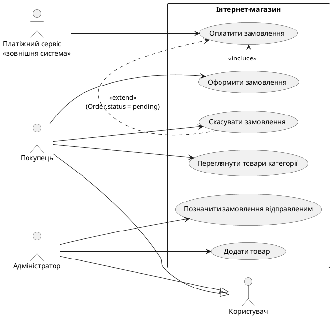
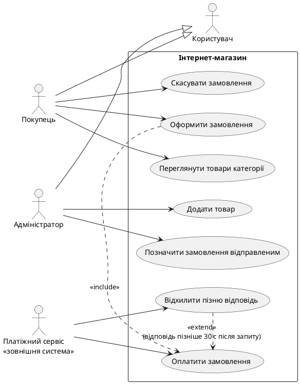

# Повна розмова — Завдання 2 (Вимоги та Use Cases)

Дата розмови: 17.10.2026. Нижче всі повідомлення по черзі: ваші промпти і відповіді Claude. Файли, які я створював, наведено повністю там, де вони з'являлися. Великі документи, які ви вставляли у повідомлення (spec.md, scenarios.feature), позначені коротко, бо їхній вміст є у відповідних файлах.

---

## 1. Користувач

*(до повідомлення додано два скриншоти: правила здачі й шаблон DEFENSE.md; Завдання 2 «Вимоги та Use Cases (EARS + user stories + Gherkin)», 16 балів, дедлайн 24 жовтня 23:59)*

> потрібно зробити 2 лр, пперед тим як писати вимоги, мені треба зробити spec.md з критеріями прийняття (сам spec має вміститися на одну сторінку) давай спочатку обговоримо: які критерії прийняття для цієї лаби взагалі можна зробити? Запропонуй 6-8 варіантів. Кожен має бути таким, щоб його можна було перевірити відповіддю так/ні. до кожного одним реченням скажи, навіщо він потрібен. Сам spec поки не пиши, я спершу виберу.

## 2. Claude

Ось 8 варіантів. Кожен перевіряється відповіддю «так/ні».

1. **Є ≥2 типи акторів, серед них людина і зовнішня система, і для кожного записана головна мета.** Це прямо вимога завдання, і без цього діаграма вийде пласкою.
2. **Кожна вимога написана за одним із шаблонів EARS (WHEN / WHILE / IF-THEN / WHERE) і містить рівно одне SHALL.** Так в одній вимозі не сховаються дві різні дії, які неможливо перевірити окремо.
3. **У вимогах немає розмитих слів («швидко», «зручно», «безпечно», «кілька») без конкретного числа чи умови.** Саме на розмитих словах вимоги стають двозначними.
4. **Кожна вимога має перевірюваний результат: тест можна написати, не питаючи автора, що він мав на увазі.** Це суть «тестованості», яку оцінюють у відмінній роботі.
5. **Для кожного основного сценарію в Gherkin є хоча б один негативний сценарій (помилка, відмова, таймаут).** Без цього сценарії описують лише «щасливий шлях», а більшість багів живе поза ним.
6. **Матриця трасування «вимога-id ↔ сценарій/UC» справді «багато-до-багатьох»: є вимога, що входить у ≥2 сценарії, і сценарій, що покриває ≥2 вимоги.** Якщо зв'язки 1:1, матриця нічого не показує, а в завданні це прямо заборонено.
7. **Є ≥1 вимога, яку свідомо не покрито сценарієм, і поруч записано пояснення чому.** Це пряма ознака відмінного виконання, а ще чесний показник того, що матрицю не підганяли.
8. **Кожна сутність, атрибут і статус, згадані у вимогах, існують у моделі даних із Завдання 1, а все нове позначене як «ПРОПОЗИЦІЯ» з поясненням.** Це «наскрізна вимога» з картинки: ланцюг моделей має бути узгодженим і не суперечити попередній роботі.

Ще два варіанти, якщо захочеш замінити якийсь із цих:

- **Діаграма use case містить хоча б один include, один extend і одне узагальнення акторів.** Це вимога завдання до рендера, але вона вже частково покривається пунктом 1 і самою діаграмою.
- **Кожна вимога має унікальний стабільний id (REQ-01…), і всі посилання в матриці та сценаріях ведуть на існуючі id.** Це захищає від «битих» посилань при правках, але більше про акуратність, ніж про зміст.

Скажи, які номери берем (або що змінити), і тоді я складу сам spec.md на одну сторінку.

---

## 3. Користувач

> окей,  1, 2, 3, 5, 6, 7, 8 і ще той що про діаграму (include, extend, узагальнення). 4 не беру, його не перевірити так/ні, воно і так виходить з 3 і 8. правки: у 3 випиши список розмитих слів, щоб було що перевіряти: швидко, зручно, безпечно, кілька, тощо, відповідно - у 8 актори не перевіряємо, бо платіжний сервіс це зовнішня система і сутністю в моделі бути не може. перевіряємо тільки сутності, атрибути й статуси. статуси Order тільки pending / paid / shipped / cancelled тепер напиши spec.md, щоб вмістився на одну сторінку. там має бути: намір (2-3 речення), актори й їхні головні цілі (щоб була людина і зовнішня система), межі (що в скоупі, що ні), сутності з моєї моделі, і критерії прийняття списком 1-8. нічого зайвого не додавай. модель така сама як я скидала вище

## 4. Claude

*(створено файл `spec.md`)*

````markdown
# spec.md — Завдання 2: Вимоги та Use Cases (інтернет-магазин)

## Намір
Описати поведінку інтернет-магазину з Завдання 1 структурованими вимогами (EARS), user stories та сценаріями Gherkin. Кожна вимога прив'язана до сценарію через матрицю трасування, а все разом узгоджене з моделлю даних із Завдання 1. Результат — вимоги, які однозначно читаються і з яких можна написати тест.

## Актори та головні цілі
| Актор | Тип | Головна ціль |
|---|---|---|
| Покупець | людина | знайти товар, оформити та оплатити замовлення, за потреби скасувати |
| Адміністратор | людина | вести каталог товарів і категорій, змінювати статуси замовлень |
| Платіжний сервіс | зовнішня система | прийняти запит на оплату і повернути результат (успіх або відмова) |

## Межі
**В скоупі:** перегляд каталогу за категоріями; оформлення замовлення; оплата через платіжний сервіс; скасування замовлення; керування каталогом і статусами замовлень адміністратором.
**Поза скоупом:** доставка, відгуки, промокоди.

## Сутності (з моделі Завдання 1)
- **User** (id UUID, name, email)
- **Category** (id UUID, name)
- **Product** (id UUID, name, price decimal, category_id FK)
- **Order** (id UUID, user_id FK, created_at datetime, status)
- **OrderItem** (id UUID, order_id FK, product_id FK, quantity int, unit_price decimal)

Статуси `Order.status`: тільки `pending` / `paid` / `shipped` / `cancelled`.

## Критерії прийняття (так/ні)
1. Є ≥2 типи акторів, серед них людина і зовнішня система, і для кожного записана головна ціль.
2. Кожна вимога написана за шаблоном EARS (WHEN / WHILE / IF-THEN / WHERE) і містить рівно одне SHALL.
3. У вимогах немає жодного зі слів: *швидко, зручно, безпечно, надійно, інтуїтивно, кілька, багато, тощо, відповідно*; замість них стоїть конкретне число чи умова.
4. Для кожного основного сценарію в Gherkin є хоча б один негативний сценарій (помилка, відмова, таймаут).
5. Матриця трасування «вимога-id ↔ сценарій/UC» справді багато-до-багатьох: є вимога, що входить у ≥2 сценарії, і сценарій, що покриває ≥2 вимоги.
6. Є ≥1 вимога, яку свідомо не покрито сценарієм, і поруч записано пояснення чому.
7. Кожна сутність, атрибут і статус, згадані у вимогах, існують у моделі з розділу «Сутності»; нове позначене як «ПРОПОЗИЦІЯ» з поясненням. Актори не перевіряються.
8. Use Case діаграма (PlantUML / Mermaid) містить хоча б один `include`, один `extend` і одне узагальнення акторів.
````

`spec.md` готовий, і він вміщується на одну сторінку.

Критерії пронумеровані 1–8 у такому порядку: актори, EARS, розмиті слова, негативні сценарії, матриця, непокрита вимога, узгодженість із моделлю, діаграма. У критерії про розмиті слова я додав до твоїх ще кілька (надійно, інтуїтивно, багато), щоб перевірка була жорсткішою. Якщо вони зайві, просто видали їх зі списку.

Для моделі я взяв ту саму, що в Завданні 1: User, Category, Product, Order і OrderItem з такими самими атрибутами. Статуси Order лише pending / paid / shipped / cancelled. У межах скоупу я записав скасування замовлення, бо статус `cancelled` у моделі є. Якщо ти не плануєш для нього вимог, просто прибери його зі скоупу.

---

## 5. Користувач

> тепер напиши вимоги історії і сценарії одним заходом 1 вимоги EARS 12-15 штук з id REQ-01 REQ-02 і так далі. таблицею id | текст | шаблон | сутність або статус з моєї моделі. одна вимога одна реакція і рівно одне SHALL. числа з одиницями де треба 2 user stories у форматі як актор я хочу дія щоб навіщо. біля кожної які REQ вона закриває. нових вимог не вигадуй якщо чогось не вистачає познач окремо 3 gherkin сценарії given when then. над кожним теги @REQ-xx може бути кілька. дані в given з моєї моделі. зроби негативні сценарії для основних. не всі вимоги треба покривати сценарієм. ті що без сценарію перелічи в кінці і напиши чому сутності і статуси тільки з моєї моделі. якщо треба щось нове познач як пропозиція і поясни

## 6. Claude

*(створено файл `requirements.md`)*

`````markdown
# Вимоги, user stories та сценарії — інтернет-магазин

## 1. Вимоги EARS

| id | текст | шаблон | сутність або статус з моделі |
|---|---|---|---|
| REQ-01 | WHEN Покупець надсилає замовлення з ≥1 позицією, система SHALL створити Order зі статусом pending. | WHEN | Order, status = pending |
| REQ-02 | WHEN система створює Order, система SHALL створити один OrderItem на кожен обраний Product. | WHEN | Order, OrderItem, Product |
| REQ-03 | WHEN система створює OrderItem, система SHALL записати в unit_price значення Product.price на цей момент. | WHEN | OrderItem.unit_price, Product.price |
| REQ-04 | IF Покупець вказує quantity менше 1 шт., THEN система SHALL відхилити створення Order. | IF-THEN | OrderItem.quantity, Order |
| REQ-05 | IF Покупець надсилає замовлення без жодної позиції, THEN система SHALL відхилити створення Order. | IF-THEN | Order, OrderItem |
| REQ-06 | WHEN Order створено зі статусом pending, система SHALL надіслати Платіжному сервісу запит на оплату суми добутків quantity × unit_price усіх OrderItem цього Order. | WHEN | Order, status = pending, OrderItem |
| REQ-07 | WHEN Платіжний сервіс підтверджує оплату протягом 30 с після запиту, система SHALL змінити статус Order з pending на paid. | WHEN | Order.status: pending → paid |
| REQ-08 | WHEN Платіжний сервіс відхиляє оплату протягом 30 с після запиту, система SHALL змінити статус Order з pending на cancelled. | WHEN | Order.status: pending → cancelled |
| REQ-09 | IF Платіжний сервіс не відповідає протягом 30 с після запиту, THEN система SHALL змінити статус Order з pending на cancelled. | IF-THEN | Order.status: pending → cancelled |
| REQ-10 | IF відповідь Платіжного сервісу надходить пізніше ніж через 30 с після запиту, THEN система SHALL залишити статус Order cancelled. | IF-THEN | Order, status = cancelled |
| REQ-11 | WHEN Покупець скасовує Order зі статусом pending, система SHALL змінити його статус на cancelled. | WHEN | Order.status: pending → cancelled |
| REQ-12 | IF Покупець скасовує Order зі статусом shipped, THEN система SHALL відхилити скасування. | IF-THEN | Order, status = shipped |
| REQ-13 | WHEN Адміністратор позначає Order зі статусом paid як відправлений, система SHALL змінити його статус на shipped. | WHEN | Order.status: paid → shipped |
| REQ-14 | IF Адміністратор додає Product з category_id неіснуючої Category, THEN система SHALL відхилити додавання. | IF-THEN | Product.category_id, Category |
| REQ-15 | WHEN Покупець обирає Category, система SHALL показати перелік Product з category_id цієї Category. | WHEN | Category, Product.category_id |

## 2. User stories

- **US-1.** Як Покупець, я хочу оформити замовлення й оплатити його, щоб отримати обрані товари. Закриває: REQ-01, REQ-02, REQ-03, REQ-04, REQ-05, REQ-06, REQ-07, REQ-08, REQ-09, REQ-10.
- **US-2.** Як Адміністратор, я хочу позначити оплачене замовлення як відправлене, щоб Покупець бачив актуальний статус свого замовлення. Закриває: REQ-13.

## 3. Сценарії Gherkin

```gherkin
Background:
  Given існує User з name "Олена" і email "olena@example.com"
  And існує Category з name "Електроніка"
  And існує Product з name "Навушники", price 1200.00 і category_id категорії "Електроніка"
```

### Основний сценарій 1 — оформлення замовлення

```gherkin
@REQ-01 @REQ-02 @REQ-03 @REQ-06
Scenario: Покупець оформлює замовлення
  When Покупець надсилає замовлення з 2 шт. Product "Навушники"
  Then створено Order зі статусом pending
  And створено один OrderItem з quantity 2 і unit_price 1200.00
  And Платіжному сервісу надіслано запит на оплату суми 2400.00
```

```gherkin
@REQ-04
Scenario: Замовлення з quantity менше 1 шт. відхиляється
  When Покупець надсилає замовлення з 0 шт. Product "Навушники"
  Then Order не створено
```

```gherkin
@REQ-05
Scenario: Замовлення без позицій відхиляється
  When Покупець надсилає замовлення без жодної позиції
  Then Order не створено
```

### Основний сценарій 2 — оплата

```gherkin
@REQ-07
Scenario: Платіжний сервіс підтверджує оплату
  Given існує Order зі статусом pending від User "Олена" з одним OrderItem (quantity 2, unit_price 1200.00)
  And Платіжному сервісу надіслано запит на оплату суми 2400.00
  When Платіжний сервіс підтверджує оплату через 10 с
  Then статус Order дорівнює paid
```

```gherkin
@REQ-08
Scenario: Платіжний сервіс відхиляє оплату
  Given існує Order зі статусом pending від User "Олена" з одним OrderItem (quantity 2, unit_price 1200.00)
  And Платіжному сервісу надіслано запит на оплату суми 2400.00
  When Платіжний сервіс відхиляє оплату через 10 с
  Then статус Order дорівнює cancelled
```

```gherkin
@REQ-09
Scenario: Платіжний сервіс не відповідає 30 с
  Given існує Order зі статусом pending від User "Олена" з одним OrderItem (quantity 2, unit_price 1200.00)
  And Платіжному сервісу надіслано запит на оплату суми 2400.00
  When від Платіжного сервісу немає відповіді 30 с
  Then статус Order дорівнює cancelled
```

```gherkin
@REQ-09 @REQ-10
Scenario: Пізня відповідь після таймауту ігнорується
  Given Order отримав статус cancelled, бо Платіжний сервіс не відповів 30 с
  When Платіжний сервіс підтверджує оплату через 45 с після запиту
  Then статус Order залишається cancelled
```

### Основний сценарій 3 — скасування замовлення

```gherkin
@REQ-11
Scenario: Покупець скасовує неоплачене замовлення
  Given існує Order зі статусом pending від User "Олена"
  When Покупець скасовує цей Order
  Then статус Order дорівнює cancelled
```

```gherkin
@REQ-12
Scenario: Скасування відправленого замовлення відхиляється
  Given існує Order зі статусом shipped від User "Олена"
  When Покупець скасовує цей Order
  Then скасування відхилено
  And статус Order залишається shipped
```

## 4. Вимоги без сценарію

- **REQ-13** — перевірка зводиться до одного переходу paid → shipped без розгалужень; я лишив лише 3 основні сценарії (оформлення, оплата, скасування), а цю вимогу закриває US-2.
- **REQ-14** — це окрема перевірка зв'язку Product → Category; вона не входить в жоден із трьох основних сценаріїв.
- **REQ-15** — вимога лише про показ переліку товарів без зміни даних, тому сценарій не додавав.

## 5. Чого не вистачає в моделі

- **ПРОПОЗИЦІЯ: User.role.** У моделі User немає ролі, тому я не писав вимог на кшталт «лише Адміністратор може позначати Order як shipped». Роль потрібна, щоб відрізнити Покупця від Адміністратора; без неї такі вимоги не можна перевірити.
- **Скасування Order зі статусом paid.** Правила для нього немає: це потребувало б повернення коштів, а відповідної сутності в моделі немає. Нічого не вигадував.
- **Припущення в REQ-08.** Відмову Платіжного сервісу я прив'язав до статусу cancelled, бо інших статусів для невдалої оплати в моделі немає (тільки pending / paid / shipped / cancelled).
`````

Усе зібране в `requirements.md`: 15 вимог EARS, 2 user stories і 3 основні сценарії Gherkin. Щоб не повторювати дані в кожному сценарії, я виніс їх у спільний `Background`.

Негативні сценарії є для кожного основного:
- **Оформлення:** quantity менше 1 шт. і замовлення без позицій.
- **Оплата:** відмова, тишa 30 с і пізня відповідь після таймауту.
- **Скасування:** спроба скасувати shipped.

Без сценарію лишилися REQ-13, REQ-14 і REQ-15, причини записані в кінці файлу.

Є три місця, де я ухвалив рішення за тебе, перевір їх:
- **Відмова оплати:** REQ-08 переводить Order у `cancelled`, бо інших статусів для невдалої оплати в моделі немає.
- **Роль користувача:** вимог на кшталт «лише Адміністратор може…» я не писав, бо в User немає ролі. Це позначено як ПРОПОЗИЦІЯ: User.role з поясненням. Якщо захочеш додати такі вимоги, вийде 16, тож доведеться об'єднати щось із наявних або прибрати REQ-15.
- **Скасування paid:** правила для нього немає, бо воно потребує повернення коштів, а відповідної сутності в моделі немає.

Банні слова зі spec (швидко, зручно тощо) у вимогах не вживаються, шаблони EARS з одним SHALL перевірив по кожній.

---

## 7. Користувач

> окей, але мені це потрібно розбити на окремі файли і коміти. я це вже роблю, тількі gherkin md чи feature

## 8. Claude

Бери `.feature`. Це стандартний формат для Gherkin: GitHub підсвічує його, теги `@REQ-xx` там працюють як справжні теги, і викладач одразу бачить, що це сценарії, а не просто текст.

Є дві дрібниці, які треба змінити, коли переносиш сценарії з мого файлу:
- На початок файлу додай рядок `Feature: Оформлення, оплата і скасування замовлення`, а `Background` постав одразу під ним.
- Заголовки на кшталт «Основний сценарій 1» у `.feature` не працюють як markdown. Замість них пиши коментарі через `#` (наприклад, `# Основний сценарій 1 — оформлення замовлення`).

Решта лишається як є: теги, `Given/When/Then` і текст кроків. Матриця трасування, user stories і таблиця вимог лишаються в `.md`.

---

## 9. Користувач

> зроби повний файл, будь ласка

## 10. Claude

*(створено файл `scenarios.feature` з усіма 9 сценаріями, `Feature:`, `Background` і коментарями замість заголовків; повний вміст — у відповіді нижче)*

Повний файл `scenarios.feature` готовий. У ньому всі 9 сценаріїв із тими самими тегами `@REQ-xx` і текстом кроків, що були в `requirements.md`. Зверху додано `Feature:` і `Background`, а заголовки основних сценаріїв стали коментарями через `#`.

Якщо розбиваєш на коміти, то цей файл логічно йде окремим комітом після таблиці вимог, бо теги в ньому посилаються на їхні id.

---

## 11. Користувач

> дай кодом

## 12. Claude

```gherkin
Feature: Оформлення, оплата і скасування замовлення

  Background:
    Given існує User з name "Олена" і email "olena@example.com"
    And існує Category з name "Електроніка"
    And існує Product з name "Навушники", price 1200.00 і category_id категорії "Електроніка"

  # Основний сценарій 1 — оформлення замовлення

  @REQ-01 @REQ-02 @REQ-03 @REQ-06
  Scenario: Покупець оформлює замовлення
    When Покупець надсилає замовлення з 2 шт. Product "Навушники"
    Then створено Order зі статусом pending
    And створено один OrderItem з quantity 2 і unit_price 1200.00
    And Платіжному сервісу надіслано запит на оплату суми 2400.00

  @REQ-04
  Scenario: Замовлення з quantity менше 1 шт. відхиляється
    When Покупець надсилає замовлення з 0 шт. Product "Навушники"
    Then Order не створено

  @REQ-05
  Scenario: Замовлення без позицій відхиляється
    When Покупець надсилає замовлення без жодної позиції
    Then Order не створено

  # Основний сценарій 2 — оплата

  @REQ-07
  Scenario: Платіжний сервіс підтверджує оплату
    Given існує Order зі статусом pending від User "Олена" з одним OrderItem (quantity 2, unit_price 1200.00)
    And Платіжному сервісу надіслано запит на оплату суми 2400.00
    When Платіжний сервіс підтверджує оплату через 10 с
    Then статус Order дорівнює paid

  @REQ-08
  Scenario: Платіжний сервіс відхиляє оплату
    Given існує Order зі статусом pending від User "Олена" з одним OrderItem (quantity 2, unit_price 1200.00)
    And Платіжному сервісу надіслано запит на оплату суми 2400.00
    When Платіжний сервіс відхиляє оплату через 10 с
    Then статус Order дорівнює cancelled

  @REQ-09
  Scenario: Платіжний сервіс не відповідає 30 с
    Given існує Order зі статусом pending від User "Олена" з одним OrderItem (quantity 2, unit_price 1200.00)
    And Платіжному сервісу надіслано запит на оплату суми 2400.00
    When від Платіжного сервісу немає відповіді 30 с
    Then статус Order дорівнює cancelled

  @REQ-09 @REQ-10
  Scenario: Пізня відповідь після таймауту ігнорується
    Given Order отримав статус cancelled, бо Платіжний сервіс не відповів 30 с
    When Платіжний сервіс підтверджує оплату через 45 с після запиту
    Then статус Order залишається cancelled

  # Основний сценарій 3 — скасування замовлення

  @REQ-11
  Scenario: Покупець скасовує неоплачене замовлення
    Given існує Order зі статусом pending від User "Олена"
    When Покупець скасовує цей Order
    Then статус Order дорівнює cancelled

  @REQ-12
  Scenario: Скасування відправленого замовлення відхиляється
    Given існує Order зі статусом shipped від User "Олена"
    When Покупець скасовує цей Order
    Then скасування відхилено
    And статус Order залишається shipped
```

---

## 13. Користувач

> окей вимоги беру як є. тепер діаграма use case в plantuml актори покупець адміністратор платіжний сервіс. покупець і адміністратор підтипи користувача. межа системи rectangle. uc покривають мій скоуп каталог замовлення оплата скасування зміна статусу. мінімум один include і один extend з умовою в дужках і узагальнення акторів. include стрілка від основного uc до того що він викликає завжди. extend стрілка від розширення до основного uc. назви uc дієслово плюс об'єкт без сутностей поза моєю моделлю після діаграми таблицею uc  які req закриває.

## 14. Claude



| UC | Назва | Актор | Закриває REQ |
|---|---|---|---|
| UC-01 | Переглянути товари категорії | Покупець | REQ-15 |
| UC-02 | Оформити замовлення | Покупець | REQ-01, REQ-02, REQ-03, REQ-04, REQ-05 |
| UC-03 | Оплатити замовлення | Платіжний сервіс | REQ-06, REQ-07, REQ-08, REQ-09, REQ-10 |
| UC-04 | Скасувати замовлення | Покупець | REQ-11, REQ-12 |
| UC-05 | Позначити замовлення відправленим | Адміністратор | REQ-13 |
| UC-06 | Додати товар | Адміністратор | REQ-14 |

- **Include:** стрілка йде від «Оформити замовлення» до «Оплатити замовлення», бо після створення Order запит на оплату надсилається завжди (REQ-06).
- **Extend:** стрілка йде від «Скасувати замовлення» до «Оплатити замовлення» з умовою `(Order.status = pending)`. Скасувати можна лише поки Order чекає оплати, і це необов'язкова гілка основного потоку (REQ-11). Для статусу shipped скасування відхиляється (REQ-12).
- **Узагальнення:** Покупець і Адміністратор успадковуються від Користувача.
- **Назви UC:** замість «Переглянути каталог» я написав «Переглянути товари категорії», бо «каталог» не є сутністю твоєї моделі, а Product і Category є. Усі 15 REQ потрапили рівно в один UC.

---

## 15. Користувач

> тепер матриця трасування таблицею в markdown колонки req-id | user story | сценарій gherkin | uc. зв'язки бери тільки з того що вже є теги @REQ в сценаріях колонка закриває в історіях і моя таблиця uc → req. нічого не підганяй де зв'язку нема лишай порожнім після таблиці списком які req без сценарію або без історії або без uc і чому по кожній

## 16. Claude

| req-id | user story | сценарій gherkin | uc |
|---|---|---|---|
| REQ-01 | US-1 | Покупець оформлює замовлення | UC-02 |
| REQ-02 | US-1 | Покупець оформлює замовлення | UC-02 |
| REQ-03 | US-1 | Покупець оформлює замовлення | UC-02 |
| REQ-04 | US-1 | Замовлення з quantity менше 1 шт. відхиляється | UC-02 |
| REQ-05 | US-1 | Замовлення без позицій відхиляється | UC-02 |
| REQ-06 | US-1 | Покупець оформлює замовлення | UC-03 |
| REQ-07 | US-1 | Платіжний сервіс підтверджує оплату | UC-03 |
| REQ-08 | US-1 | Платіжний сервіс відхиляє оплату | UC-03 |
| REQ-09 | US-1 | Платіжний сервіс не відповідає 30 с; Пізня відповідь після таймауту ігнорується | UC-03 |
| REQ-10 | US-1 | Пізня відповідь після таймауту ігнорується | UC-03 |
| REQ-11 | | Покупець скасовує неоплачене замовлення | UC-04 |
| REQ-12 | | Скасування відправленого замовлення відхиляється | UC-04 |
| REQ-13 | US-2 | | UC-05 |
| REQ-14 | | | UC-06 |
| REQ-15 | | | UC-01 |

Зв'язки «багато-до-багатьох» видно в самій таблиці: сценарій «Покупець оформлює замовлення» закриває чотири вимоги (REQ-01, 02, 03, 06), а REQ-09 входить у два сценарії.

**REQ без сценарію**
- **REQ-13:** перевірка зводиться до одного переходу paid → shipped, а я лишив лише 3 основні сценарії (оформлення, оплата, скасування); вимогу закриває US-2.
- **REQ-14:** це окрема перевірка зв'язку Product → Category, вона не входить в жоден з трьох основних сценаріїв.
- **REQ-15:** вимога лише про показ переліку товарів без зміни даних, тому сценарій не додавали.

**REQ без user story**
- **REQ-11, REQ-12:** обидві історії стосуються інших цілей (US-1 про оформлення й оплату, US-2 про відправку), а скасування покупця окремої історії не має.
- **REQ-14, REQ-15:** додавання товару й перегляд категорії теж не потрапили в жодну з двох історій.

**REQ без UC**
- Таких немає, кожна вимога з таблиці UC → REQ потрапила в один UC.

---

## 17. Користувач

*(вставлено оновлений `spec.md` з додатковими критеріями 9, 10, 11)*

> є три моменти які треба переробити 1 у сценарії про пізню відповідь після таймауту given каже що order cancelled і then теж каже cancelled тобто тест не може впасти. і req-10 просто залишити cancelled це нічого не робить. я додала в spec критерій 9. перероби req-10 і сценарій щоб була видима реакція системи 2 скасувати замовлення ти зробив extend до оплатити. але скасування це окрема ціль покупця а не необов'язкове продовження оплати. я додала критерій 10. зроби скасування окремим uc а extend зроби для чогось що справді необов'язкове продовження оплати і поясни одним реченням 3 req-13 і req-14 тримаються на адміністраторі а в моїй моделі в user нема ролі. я додала критерій 11. познач як пропозицію user.role і додай вимогу що покупець не може робити дії адміністратора і сценарій на це

## 18. Claude

Нижче тільки змінене, решта лишається як було. Усі три зауваження слушні.

### 1. REQ-10 і сценарій про пізню відповідь

Тепер у вимозі є видима реакція: система повертає Платіжному сервісу відхилення. Статус там лишається `cancelled` як наслідок, але перевіряється саме відхилення.

| id | текст | шаблон | сутність або статус з моделі |
|---|---|---|---|
| REQ-10 | IF відповідь Платіжного сервісу на запит оплати Order надходить пізніше ніж через 30 с після запиту, THEN система SHALL повернути Платіжному сервісу відхилення цієї відповіді. | IF-THEN | Order |

```gherkin
  @REQ-09 @REQ-10
  Scenario: Пізня відповідь після таймауту відхиляється
    Given Order отримав статус cancelled, бо Платіжний сервіс не відповів 30 с
    When Платіжний сервіс підтверджує оплату через 45 с після запиту
    Then Платіжному сервісу повернуто відхилення відповіді
```

Припущення: система має канал, яким відповідає Платіжному сервісу. Нових сутностей для цього не потрібно.

### 2. Скасування окремо, extend для справді необов'язкового



«Скасувати замовлення» тепер самостійна ціль Покупця без зв'язків із оплатою, а extend отримало «Відхилити пізню відповідь», бо воно відбувається лише в рідкісному випадку запізнілої відповіді, а звичайна оплата проходить без нього.

| UC | Назва | Актор | Закриває REQ |
|---|---|---|---|
| UC-01 | Переглянути товари категорії | Покупець | REQ-15 |
| UC-02 | Оформити замовлення | Покупець | REQ-01, REQ-02, REQ-03, REQ-04, REQ-05 |
| UC-03 | Оплатити замовлення | Платіжний сервіс | REQ-06, REQ-07, REQ-08, REQ-09 |
| UC-04 | Скасувати замовлення | Покупець | REQ-11, REQ-12 |
| UC-05 | Позначити замовлення відправленим | Адміністратор | REQ-13 |
| UC-06 | Додати товар | Адміністратор | REQ-14 |
| UC-07 | Відхилити пізню відповідь | Платіжний сервіс | REQ-10 |

### 3. User.role як пропозиція

Нова вимога:

| id | текст | шаблон | сутність або статус з моделі |
|---|---|---|---|
| REQ-16 | IF User з role buyer намагається виконати дію Адміністратора, THEN система SHALL відхилити цю дію. | IF-THEN | **ПРОПОЗИЦІЯ: User.role** |

Тут «дія Адміністратора» означає дії з REQ-13 і REQ-14. У колонці сутностей REQ-13 і REQ-14 також дописати `ПРОПОЗИЦІЯ: User.role`, бо вони тримаються на ролі.

```gherkin
  @REQ-16
  Scenario: Покупець не може позначити замовлення відправленим
    Given User "Олена" має role buyer
    And існує Order зі статусом paid від User "Олена"
    When Олена намагається позначити цей Order відправленим
    Then дію відхилено
```

Замість пункту про роль у розділі «Чого не вистачає в моделі» (він був у `requirements.md`) постав такий:

> **ПРОПОЗИЦІЯ: User.role.** Нове поле в User зі значеннями `buyer` / `admin`. Модель Завдання 1 не відрізняє Покупця від Адміністратора, а REQ-13, REQ-14 і REQ-16 без цього не перевірити.

### Матриця: змінені рядки

| req-id | user story | сценарій gherkin | uc |
|---|---|---|---|
| REQ-09 | US-1 | Платіжний сервіс не відповідає 30 с; Пізня відповідь після таймауту відхиляється | UC-03 |
| REQ-10 | US-1 | Пізня відповідь після таймауту відхиляється | UC-07 |
| REQ-16 | | Покупець не може позначити замовлення відправленим | |

Зміни у списках після матриці:
- **Без історії:** до REQ-11, 12, 14, 15 додається REQ-16, бо жодна з двох історій не про обмеження доступу.
- **Без UC:** тепер є REQ-16, бо це умова доступу до UC-05 і UC-06, а не самостійна ціль актора.
- **Без сценарію:** без змін (REQ-13, 14, 15). Сценарій REQ-16 перевіряє лише відмову Покупцю, тому тег `@REQ-13` я не ставив, інакше вона вважалася б покритою.

Тепер вимог 16 замість 12–15. Якщо треба вкластися, REQ-04 і REQ-05 можна злити в одну, бо в обох реакція «відхилити створення Order», але тоді зміняться id.

---

## 19. Користувач

*(вставлено оновлений `spec.md` і `scenarios.feature`, а також поточну матрицю трасування)*

> кілька правок по сценаріях 1 сценарії для req-04 і req-05 закінчуються на order не створено. до події order не було і після нема тобто нічого не видно. у моєму spec критерій 9 then має показувати реакцію системи. перероби then щоб було видно саме відхилення. нічого нового не вигадуй типу текстів повідомлень 2 req-13 і req-15 можна перевірити сценарієм тому додай для них сценарії. для адміністратора в given бери user з role admin 3 req-14 залиш без сценарію бо category_id це fk в моїй моделі і бд сама не дасть вставити неіснуючу категорію. напиши це як причину в матриці. і познач що uc-06 теж без сценарію видай тільки змінені сценарії і оновлену матрицю

## 20. Claude

Це чотири сценарії: два переписані (REQ-04, REQ-05) і два нові (REQ-13, REQ-15). Решту лишай як є.

```gherkin
  @REQ-04
  Scenario: Замовлення з quantity менше 1 шт. відхиляється
    When Покупець надсилає замовлення з 0 шт. Product "Навушники"
    Then створення Order відхилено

  @REQ-05
  Scenario: Замовлення без позицій відхиляється
    When Покупець надсилає замовлення без жодної позиції
    Then створення Order відхилено
```

Нові сценарії: REQ-15 став поряд з основним сценарієм 1, а REQ-13 став до сценарію REQ-16 в розділ «Доступ адміністратора».

```gherkin
  @REQ-15
  Scenario: Покупець переглядає товари категорії
    Given існує Category з name "Одяг"
    And існує Product з name "Футболка", price 500.00 і category_id категорії "Одяг"
    When Покупець обирає Category "Електроніка"
    Then показано Product "Навушники"
    And Product "Футболка" не показано

  @REQ-13
  Scenario: Адміністратор позначає оплачене замовлення відправленим
    Given існує User з name "Тарас" і role admin
    And існує Order зі статусом paid від User "Олена"
    When Тарас позначає цей Order відправленим
    Then статус Order дорівнює shipped
```

У `.feature` тег `@REQ-09 @REQ-10` стоїть із трьома пробілами замість двох, тож варто вирівняти.

```markdown
# Матриця трасування

| req-id | user story | сценарій gherkin | uc |
|---|---|---|---|
| REQ-01 | US-1 | Покупець оформлює замовлення | UC-02 |
| REQ-02 | US-1 | Покупець оформлює замовлення | UC-02 |
| REQ-03 | US-1 | Покупець оформлює замовлення | UC-02 |
| REQ-04 | US-1 | Замовлення з quantity менше 1 шт. відхиляється | UC-02 |
| REQ-05 | US-1 | Замовлення без позицій відхиляється | UC-02 |
| REQ-06 | US-1 | Покупець оформлює замовлення | UC-03 |
| REQ-07 | US-1 | Платіжний сервіс підтверджує оплату | UC-03 |
| REQ-08 | US-1 | Платіжний сервіс відхиляє оплату | UC-03 |
| REQ-09 | US-1 | Платіжний сервіс не відповідає 30 с; Пізня відповідь після таймауту відхиляється | UC-03 |
| REQ-10 | US-1 | Пізня відповідь після таймауту відхиляється | UC-07 |
| REQ-11 | | Покупець скасовує неоплачене замовлення | UC-04 |
| REQ-12 | | Скасування відправленого замовлення відхиляється | UC-04 |
| REQ-13 | US-2 | Адміністратор позначає оплачене замовлення відправленим | UC-05 |
| REQ-14 | | | UC-06 |
| REQ-15 | | Покупець переглядає товари категорії | UC-01 |
| REQ-16 | | Покупець не може позначити замовлення відправленим | |

## UC → REQ

| UC | Назва | Актор | Закриває REQ |
|---|---|---|---|
| UC-01 | Переглянути товари категорії | Покупець | REQ-15 |
| UC-02 | Оформити замовлення | Покупець | REQ-01, REQ-02, REQ-03, REQ-04, REQ-05 |
| UC-03 | Оплатити замовлення | Платіжний сервіс | REQ-06, REQ-07, REQ-08, REQ-09 |
| UC-04 | Скасувати замовлення | Покупець | REQ-11, REQ-12 |
| UC-05 | Позначити замовлення відправленим | Адміністратор | REQ-13 |
| UC-06 | Додати товар (без сценарію) | Адміністратор | REQ-14 |
| UC-07 | Відхилити пізню відповідь | Платіжний сервіс | REQ-10 |

## Вимоги без сценарію (навмисно)

- **REQ-14:** category_id є зовнішнім ключем (FK) у моделі, тому база даних сама не дасть вставити Product з неіснуючою Category, і окремий сценарій нічого б не додав. Через це UC-06 теж лишається без сценарію.

## Вимоги без user story

REQ-11, REQ-12, REQ-14, REQ-15, REQ-16.

## Вимоги без UC

REQ-16: це умова доступу до UC-05 і UC-06, а не самостійна ціль актора.
```

---

## 21. Користувач

> ти можешь зробити файл з повною нашою розмовою

## 22. Claude

Це цей файл. Тут усі ваші повідомлення і мої відповіді в тому порядку, як вони були в чаті. Файли, які я створював (`spec.md`, `requirements.md`), наведені повністю в тій версії, що була на момент створення. Пізніші зміни до них описані у відповідях 18 і 20.
