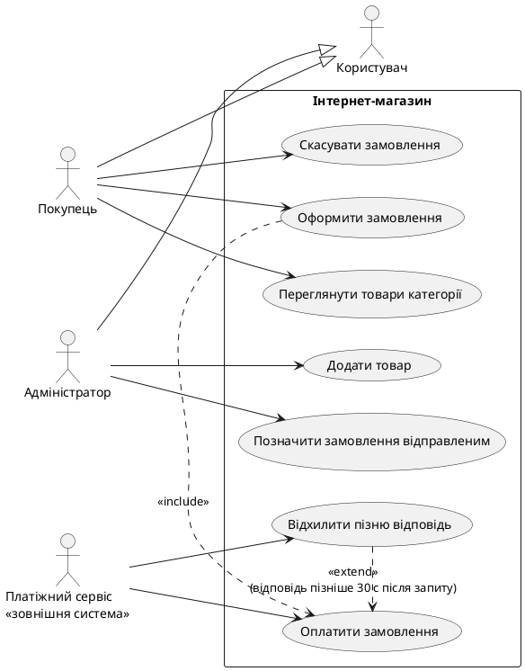

# Три помилки AI і як їх виправлено

Повний діалог із AI: `conversation-lab2.md`. Усі три помилки зробив AI у своїх відповідях, а я знайшла їх, перевіряючи вивід. Кожну виправлено через новий критерій у `spec.md`, після чого AI переписував свою відповідь.

## 1. Сценарії не показують реакцію системи: Then повторює Given

**У чому помилка AI.** AI написав вимогу REQ-10, яка описує відсутність дії (залишити статус cancelled), і сценарії, де Then повторює стан, що був до події: Order уже cancelled і залишається cancelled, Order не було і Order не створено. Такі сценарії перевіряють лише «нічого не змінилось» і не показують, що система відреагувала на подію, тому з них не видно, що саме система мала зробити.

Вимога AI:

````````
| REQ-10 | IF відповідь Платіжного сервісу надходить пізніше ніж через 30 с після запиту, THEN система SHALL залишити статус Order cancelled. | IF-THEN | Order, status = cancelled |
````````

Сценарії AI:

````````
@REQ-09 @REQ-10
Scenario: Пізня відповідь після таймауту ігнорується
  Given Order отримав статус cancelled, бо Платіжний сервіс не відповів 30 с
  When Платіжний сервіс підтверджує оплату через 45 с після запиту
  Then статус Order залишається cancelled

@REQ-04
Scenario: Замовлення з quantity менше 1 шт. відхиляється
  When Покупець надсилає замовлення з 0 шт. Product "Навушники"
  Then Order не створено

@REQ-05
Scenario: Замовлення без позицій відхиляється
  When Покупець надсилає замовлення без жодної позиції
  Then Order не створено
````````

**Що я йому написала.**

````````
є три моменти які треба переробити
1 у сценарії про пізню відповідь після таймауту given каже що order cancelled і then теж каже cancelled тобто тест не може впасти. і req-10 просто залишити cancelled це нічого не робить. я додала в spec критерій 9. перероби req-10 і сценарій щоб була видима реакція системи
````````

Окремим повідомленням:

````````
кілька правок по сценаріях
1 сценарії для req-04 і req-05 закінчуються на order не створено. до події order не було і після нема тобто нічого не видно. у моєму spec критерій 9 then має показувати реакцію системи. перероби then щоб було видно саме відхилення. нічого нового не вигадуй типу текстів повідомлень
````````

**Що відповів AI.**

````````
Нижче тільки змінене, решта лишається як було. Усі три зауваження слушні.

### 1. REQ-10 і сценарій про пізню відповідь

Тепер у вимозі є видима реакція: система повертає Платіжному сервісу відхилення. Статус там лишається `cancelled` як наслідок, але перевіряється саме відхилення.

| id | текст | шаблон | сутність або статус з моделі |
|---|---|---|---|
| REQ-10 | IF відповідь Платіжного сервісу на запит оплати Order надходить пізніше ніж через 30 с після запиту, THEN система SHALL повернути Платіжному сервісу відхилення цієї відповіді. | IF-THEN | Order |

```gherkin
  @REQ-09 @REQ-10
  Scenario: Пізня відповідь після таймауту відхиляється
    Given Order отримав статус cancelled, бо Платіжний сервіс не відповів 30 с
    When Платіжний сервіс підтверджує оплату через 45 с після запиту
    Then Платіжному сервісу повернуто відхилення відповіді
```

Припущення: система має канал, яким відповідає Платіжному сервісу. Нових сутностей для цього не потрібно.
````````

І на другу правку:

````````
Це чотири сценарії: два переписані (REQ-04, REQ-05) і два нові (REQ-13, REQ-15). Решту лишай як є.

```gherkin
  @REQ-04
  Scenario: Замовлення з quantity менше 1 шт. відхиляється
    When Покупець надсилає замовлення з 0 шт. Product "Навушники"
    Then створення Order відхилено

  @REQ-05
  Scenario: Замовлення без позицій відхиляється
    When Покупець надсилає замовлення без жодної позиції
    Then створення Order відхилено
```
````````

**Як проблему вирішили.** Я додала в `spec.md` критерій 9: Then не повторює Given і описує видиму реакцію системи (коміт `4f05ded`). Після цього AI переписав REQ-10 і сценарій (коміт `589d087`), а Then у REQ-04 і REQ-05 замінено на «створення Order відхилено» (коміт `dad827a`).

---

## 2. Extend використано для самостійної цілі

**У чому помилка AI.** AI зробив «Скасувати замовлення» розширенням (extend) до «Оплатити замовлення». Але скасування є самостійною ціллю Покупця: Order у статусі pending можна скасувати й до початку оплати. Extend має означати необов'язкове продовження основного сценарію, а не окрему дію.

Діаграма AI:

````````
  usecase "Скасувати замовлення" as UC04
Buyer --> UC04
UC02 .> UC03 : <<include>>
UC04 .> UC03 : <<extend>>\n(Order.status = pending)

- **Extend:** стрілка йде від «Скасувати замовлення» до «Оплатити замовлення» з умовою `(Order.status = pending)`. Скасувати можна лише поки Order чекає оплати, і це необов'язкова гілка основного потоку (REQ-11). Для статусу shipped скасування відхиляється (REQ-12).
````````

**Що я йому написала.**

````````
2 скасувати замовлення ти зробив extend до оплатити. але скасування це окрема ціль покупця а не необов'язкове продовження оплати. я додала критерій 10. зроби скасування окремим uc а extend зроби для чогось що справді необов'язкове продовження оплати і поясни одним реченням
````````

**Що відповів AI.**

````````
### 2. Скасування окремо, extend для справді необов'язкового



«Скасувати замовлення» тепер самостійна ціль Покупця без зв'язків із оплатою, а extend отримало «Відхилити пізню відповідь», бо воно відбувається лише в рідкісному випадку запізнілої відповіді, а звичайна оплата проходить без нього.

| UC | Назва | Актор | Закриває REQ |
|---|---|---|---|
| UC-01 | Переглянути товари категорії | Покупець | REQ-15 |
| UC-02 | Оформити замовлення | Покупець | REQ-01, REQ-02, REQ-03, REQ-04, REQ-05 |
| UC-03 | Оплатити замовлення | Платіжний сервіс | REQ-06, REQ-07, REQ-08, REQ-09 |
| UC-04 | Скасувати замовлення | Покупець | REQ-11, REQ-12 |
| UC-05 | Позначити замовлення відправленим | Адміністратор | REQ-13 |
| UC-06 | Додати товар | Адміністратор | REQ-14 |
| UC-07 | Відхилити пізню відповідь | Платіжний сервіс | REQ-10 |
````````

**Як проблему вирішили.** Я додала в `spec.md` критерій 10: extend лише для необов'язкового продовження основного UC, самостійна ціль актора це окремий UC (коміт `518342c`). AI зробив скасування окремим UC, а extend отримав «Відхилити пізню відповідь» (коміт `d7730ce`, матриця трасування оновлена в `ceeed26`).

---

## 3. Адміністратор не прив'язаний до моделі

**У чому помилка AI.** AI написав REQ-13 і REQ-14 для Адміністратора, хоча в User із моєї моделі немає ролі (тільки id, name, email), тож система не знає, хто Адміністратор. У нотатці про прогалини він згадав це, але в таблиці вимог ці дві вимоги виглядали звичайними, без позначки, а вимоги, що Покупець не може виконувати ці дії, не було.

Вимоги і нотатка AI:

````````
| REQ-13 | WHEN Адміністратор позначає Order зі статусом paid як відправлений, система SHALL змінити його статус на shipped. | WHEN | Order.status: paid → shipped |
| REQ-14 | IF Адміністратор додає Product з category_id неіснуючої Category, THEN система SHALL відхилити додавання. | IF-THEN | Product.category_id, Category |

## 5. Чого не вистачає в моделі

- **ПРОПОЗИЦІЯ: User.role.** У моделі User немає ролі, тому я не писав вимог на кшталт «лише Адміністратор може позначати Order як shipped». Роль потрібна, щоб відрізнити Покупця від Адміністратора; без неї такі вимоги не можна перевірити.
- **Скасування Order зі статусом paid.** Правила для нього немає: це потребувало б повернення коштів, а відповідної сутності в моделі немає. Нічого не вигадував.
````````

**Що я йому написала.**

````````
3 req-13 і req-14 тримаються на адміністраторі а в моїй моделі в user нема ролі. я додала критерій 11. познач як пропозицію user.role і додай вимогу що покупець не може робити дії адміністратора і сценарій на це
````````

**Що відповів AI.**

````````
### 3. User.role як пропозиція

Нова вимога:

| id | текст | шаблон | сутність або статус з моделі |
|---|---|---|---|
| REQ-16 | IF User з role buyer намагається виконати дію Адміністратора, THEN система SHALL відхилити цю дію. | IF-THEN | **ПРОПОЗИЦІЯ: User.role** |

Тут «дія Адміністратора» означає дії з REQ-13 і REQ-14. У колонці сутностей REQ-13 і REQ-14 також дописати `ПРОПОЗИЦІЯ: User.role`, бо вони тримаються на ролі.

```gherkin
  @REQ-16
  Scenario: Покупець не може позначити замовлення відправленим
    Given User "Олена" має role buyer
    And існує Order зі статусом paid від User "Олена"
    When Олена намагається позначити цей Order відправленим
    Then дію відхилено
```

Замість пункту про роль у розділі «Чого не вистачає в моделі» (він був у `requirements.md`) постав такий:

> **ПРОПОЗИЦІЯ: User.role.** Нове поле в User зі значеннями `buyer` / `admin`. Модель Завдання 1 не відрізняє Покупця від Адміністратора, а REQ-13, REQ-14 і REQ-16 без цього не перевірити.
````````

**Як проблему вирішили.** Я додала в `spec.md` критерій 11: якщо вимога спирається на роль, якої немає в моделі, її позначають «ПРОПОЗИЦІЯ: User.role», і є вимога та сценарій, що інша роль цю дію виконати не може (коміт `0d1ed28`). AI додав REQ-16 і сценарій, позначив REQ-13 і REQ-14 (коміт `a530759`).